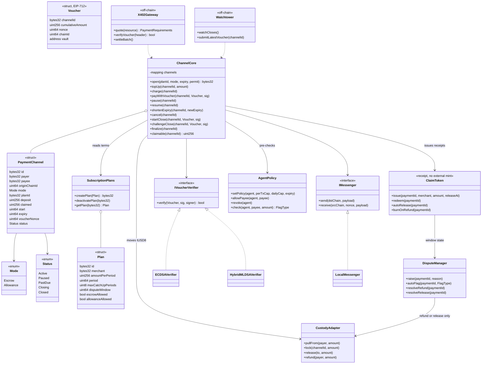
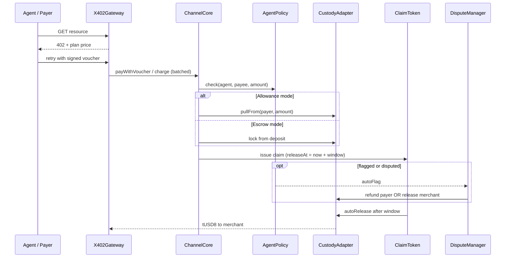

# Aevum Payment Protocol

Aevum Builder Challenge #1. One payment channel type with two funding modes (**Escrow** and **Allowance**), and one payment pipeline that mints **claim tokens**. Claims settle to the merchant after a configurable dispute window. Pay-per-use goes through an **x402** gateway with off-chain vouchers.

> **Status: boilerplate only.** Every contract function reverts `NotImplemented()`. Every test is a named, skipped placeholder. Backend `verifyVoucher` and `settleBatch` return HTTP 501. Frontend pages are headings with TODO lists. The source of truth for names, structs, signatures and relationships is the UML in [`docs/uml/`](docs/uml/): [class diagram](docs/uml/class-diagram.md), [sequence diagram](docs/uml/sequence-diagram.md) and [core invariants](docs/uml/README.md#core-invariants).

## Network

| | |
|---|---|
| Network | **QDay Aevum testnet** |
| Chain ID | `44005` |
| RPC | https://rpc-test.qday.info |
| Explorer | https://explorer-test.qday.info |
| tUSD8 | `0x456569838f1d43009A91ebA4263147Afd7233483` (ERC-20, 6 decimals, EIP-2612 permit) |

⚠️ **Not** the QDay Origin testnet (`44003`, `rpc.qday.info`). Nothing should point at it. The backend env validation, `assertAllowedNetwork` in `/shared`, and `Deploy.s.sol` all reject it.

## Architecture

These diagrams are the source of truth for names, structs, function signatures and relationships. The original document is [`docs/uml/aevum-payment-protocol-uml.html`](docs/uml/aevum-payment-protocol-uml.html); the core invariants are in [`docs/uml/README.md`](docs/uml/README.md#core-invariants).

### Class diagram (UML)



### Payment flow (sequence diagram)



## Folder map

```
.
├── package.json            npm workspaces root: build / test / lint / abi
├── tsconfig.base.json      shared TS compiler options
├── .env.example            every variable; copy to .env (gitignored)
├── docs/uml/               original UML HTML + GitHub-rendered Mermaid class and sequence diagrams
├── contracts/              Foundry
│   ├── foundry.toml        solc 0.8.26, evm paris, optimizer 200, fuzz 256, invariant 64×50, aevum rpc, blockscout
│   ├── src/
│   │   ├── types/          Enums.sol (Mode, Status, FlagType), Structs.sol (PaymentChannel, Plan, Voucher, Permit), Errors.sol
│   │   ├── interfaces/     IChannelCore, ISubscriptionPlans, ICustodyAdapter, IClaimToken, IDisputeManager,
│   │   │                   IAgentPolicy, IVoucherVerifier, IMessenger (NatSpec, events, custom errors)
│   │   └── *.sol           ChannelCore, SubscriptionPlans, CustodyAdapter, ClaimToken, DisputeManager,
│   │                       AgentPolicy, ECDSAVerifier, HybridMLDSAVerifier, LocalMessenger
│   ├── script/             Deploy.s.sol (+ DeployProtocol.sol shared wiring)
│   ├── test/
│   │   ├── mocks/          MockTUSD8 (ERC20 + Permit, 6 decimals, open mint; tests only)
│   │   ├── utils/          Base.t.sol (deploys + wires everything; payer, merchant, agent, arbiter)
│   │   ├── unit/           one file per contract, test_<function>_<case>
│   │   ├── fuzz/           testFuzz_ accrual, catch-up, rounding, voucher monotonicity, dispute window
│   │   ├── invariant/      Handler.sol (ghosts + actions), Invariants.t.sol (one per UML invariant)
│   │   └── symbolic/       Halmos check_ stubs
│   └── lib/                forge-std v1.17.0, openzeppelin-contracts v5.4.0 (git submodules)
├── shared/                 @aevum/shared
│   ├── scripts/copy-abis.mjs   contracts/out → src/abi/*.ts (typed `as const`)
│   └── src/                chain.ts, types.ts, eip712.ts, x402.ts, abi/
├── backend/                @aevum/backend (Fastify, viem, zod)
│   ├── src/config/         env.ts (zod), chain.ts (viem client from /shared)
│   ├── src/x402/           routes.ts, gateway.ts (quote / verifyVoucher / settleBatch), catalog.ts
│   ├── src/watchtower/     worker.ts (watchCloses / submitLatestVoucher)
│   ├── src/store/          VoucherStore + ReceiptStore interfaces, in-memory stub
│   └── test/               vitest placeholder
└── frontend/               @aevum/frontend (Vite, React, wagmi, viem, React Router, plain CSS)
    └── src/                pages/ (Plans, Subscribe, MyChannels, Merchant, AgentPolicy),
                            components/ (ConnectButton, AddNetworkButton), lib/addNetwork.ts, wagmi.ts
```

## Setup

Prerequisites: **Node.js ≥ 22**, **npm ≥ 10**, **Foundry** (`foundryup`).

```bash
git clone --recurse-submodules https://github.com/safi-ullah08/aevum-payment-protocol.git
```

```bash
cd aevum-payment-protocol
```

If you cloned without `--recurse-submodules`:

```bash
git submodule update --init --recursive
```

```bash
npm install
```

```bash
cp .env.example .env
```

```bash
npm run build
```

```bash
npm test
```

## Commands

### Root (runs across workspaces)

| Command | What it does |
|---|---|
| `npm run build` | `forge build` → copy ABIs into `/shared` → build shared → backend → frontend |
| `npm test` | `forge test` (all skipped) + backend `vitest run` (skipped placeholder) |
| `npm run lint` | `forge fmt --check` + `tsc --noEmit` in shared, backend, frontend |
| `npm run abi` | Re-copy ABIs from `contracts/out` into `shared/src/abi` |

### Contracts (`cd contracts`)

| Command | What it does |
|---|---|
| `forge build` | Compile (solc 0.8.26, `evm_version = paris`) |
| `forge test` | Run all tests (currently every test is skipped) |
| `forge test --mc ChannelCoreTest -vvv` | One suite, verbose |
| `forge fmt` / `forge fmt --check` | Format / check formatting |
| `halmos --contract Symbolic` | Symbolic tests (install with `pip install halmos`; not run in CI yet) |
| `forge script script/Deploy.s.sol --rpc-url aevum --broadcast --account <keystore>` | Deploy to Aevum testnet (needs `TUSD8_ADDRESS`, `ARBITER_ADDRESS` in env; `set -a; source ../.env; set +a`) |
| `forge verify-contract <addr> src/ChannelCore.sol:ChannelCore --chain 44005 --verifier blockscout --verifier-url https://explorer-test.qday.info/api/` | Verify on Blockscout |

npm wrappers: `npm run build|test|lint|fmt|deploy:aevum -w contracts`.

### Shared

| Command | What it does |
|---|---|
| `npm run build -w shared` | Copy ABIs, then `tsc` to `shared/dist` |
| `npm run abi -w shared` | Copy ABIs only |
| `npm run lint -w shared` | Type-check |

### Backend

| Command | What it does |
|---|---|
| `npm run dev -w backend` | `tsx watch` on http://127.0.0.1:3001 |
| `npm run build -w backend` | `tsc` to `backend/dist` |
| `npm start -w backend` | Run the built server |
| `npm test -w backend` | `vitest run` |
| `npm run lint -w backend` | Type-check |

Endpoints: `GET /health`; `GET /resource/:id` (402 with x402 `PaymentRequirements`; with an `X-PAYMENT` header → 501 until `verifyVoucher` is implemented); `POST /x402/settle` (501).

### Frontend

| Command | What it does |
|---|---|
| `npm run dev -w frontend` | Vite dev server on http://localhost:5173 |
| `npm run build -w frontend` | Type-check + production build |
| `npm run preview -w frontend` | Serve the production build |
| `npm run lint -w frontend` | Type-check |

The frontend reads `VITE_*` variables from the root `.env` (`envDir: '..'`).

## Secrets

- No keys in the repo. `.env` and `.env.*` are gitignored; only `.env.example` is tracked.
- Deploy keys go to forge on the CLI (`--account` keystore, `--ledger`, or `--private-key`), never into a file in the repo.
- Backend keys (`GATEWAY_PRIVATE_KEY`, `WATCHTOWER_PRIVATE_KEY`) are read from `.env` and validated by zod.
- Never put secrets in `VITE_*` variables: Vite inlines them into the public bundle.

## Toolchain notes

- **EVM version is `paris`.** Aevum does not support `MCOPY`, and Cancun bytecode breaks memory reads there.
- **OpenZeppelin is pinned to v5.4.0.** v5.5.0+ uses `mcopy` in `utils/Bytes.sol`, which `ERC20Permit` pulls in, and that fails to compile for Paris. Check this before upgrading.
- `foundry.toml` ignores solc warning 2018 ("can be restricted to pure/view") because every stub body only reverts. **Remove it once the stubs are implemented.**
- The only remaining compiler warning is 3445, for `IMessenger.receive` (see Open questions).
- TypeScript is pinned to `~5.9` (TypeScript 7 fails declaration emit for viem chain types).
- `forge test` ignores `check_` functions; they run only under Halmos. Halmos has no skip cheatcode, so the stubs revert `NotImplemented()`, which Halmos does not count as a counterexample. They prove nothing until implemented.

## Implementation checklist

Work top to bottom. Resolve the related **Open questions** before each item.

### 1. Contracts (`contracts/src`)

- [ ] Settle the open type questions: `FlagType` values, `Permit` shape, party `bytes32` ↔ `address` mapping, `ClaimToken` standard
- [ ] `SubscriptionPlans`: `createPlan`, `deactivatePlan`, `getPlan`
- [ ] `AgentPolicy`: `setPolicy`, `allowPayee`, `revoke`, `check`
- [ ] `ECDSAVerifier.verify` (EIP-712 domain must match `shared/src/eip712.ts`)
- [ ] `CustodyAdapter`: `pullFrom`, `lock`, `release`, `refund` (SafeERC20, caller allowlists)
- [ ] `ClaimToken`: `issue`, `redeem`, `autoRelease`, `burnOnRefund`
- [ ] `DisputeManager`: `raise`, `autoFlag`, `resolveRefund`, `resolveRelease`
- [ ] `ChannelCore`: `open`, `topUp`, `claimable`, `charge`
- [ ] `ChannelCore`: `payWithVoucher`
- [ ] `ChannelCore`: `pause`, `resume`, `shortenExpiry`, `cancel`
- [ ] `ChannelCore`: `startClose`, `challengeClose`, `finalize`
- [ ] `LocalMessenger`: `send`, `receive`
- [ ] `HybridMLDSAVerifier.verify`
- [ ] Remove `ignored_error_codes = [2018]` from `foundry.toml`
- [ ] Deploy to Aevum testnet, verify on Blockscout, fill addresses in `.env`

### 2. Tests (`contracts/test`)

- [ ] Unit: `SubscriptionPlans.t.sol`, `AgentPolicy.t.sol`, `ECDSAVerifier.t.sol`, `CustodyAdapter.t.sol`, `ClaimToken.t.sol`, `DisputeManager.t.sol`, `ChannelCore.t.sol`, `LocalMessenger.t.sol`, `HybridMLDSAVerifier.t.sol` (replace each `vm.skip(true)` with the asserted behaviour)
- [ ] Fuzz: `AccrualFuzz`, `CatchUpFuzz`, `RoundingFuzz`, `VoucherMonotonicityFuzz`, `DisputeWindowFuzz`
- [ ] Invariant `Handler.sol`: implement all 13 actions and ghost bookkeeping
- [ ] `Invariants.t.sol`: implement the 7 `invariant_` functions
- [ ] Symbolic: `check_conservationOfFunds`, `check_atMostOneChargePerPeriod`, `check_staleVoucherNeverSettles`; add Halmos to CI

### 3. Backend (`backend/src`)

- [ ] Replace `InMemoryVoucherStore` / `InMemoryReceiptStore` with a **durable** store. An in-memory replay set re-accepts old payments after a restart.
- [ ] `x402/catalog.ts`: read plans on-chain via `SubscriptionPlans.getPlan`
- [ ] `x402/gateway.ts`: `verifyVoucher` (decode `X-PAYMENT`, EIP-712 verify, replay check, store latest)
- [ ] Paid-retry path: record receipt, set `X-PAYMENT-RESPONSE`, return resource
- [ ] `x402/gateway.ts`: `settleBatch` (latest voucher per channel → `ChannelCore.payWithVoucher`)
- [ ] `watchtower/worker.ts`: `watchCloses`, `submitLatestVoucher`; start it from `index.ts`
- [ ] Real tests in `backend/test`

### 4. Frontend (`frontend/src/pages`)

- [ ] Plans
- [ ] Subscribe (permit signing + `open`)
- [ ] My channels (pause / resume / cancel / top up / shorten expiry / close)
- [ ] Merchant (create plan, claims, dispute queue)
- [ ] Agent policy (caps, allowlist, revoke)

## Open questions

The UML leaves these points unspecified or inconsistent. The scaffold makes the smallest assumption needed to compile, and marks each one in code with a pointer here.

1. **`FlagType` values.** The UML uses `FlagType` (`AgentPolicy.check`, `DisputeManager.autoFlag`) but never lists its values. The scaffold uses `None, NoPolicy, PolicyExpired, PerTxCapExceeded, DailyCapExceeded, PayeeNotAllowed`, inferred from `setPolicy` / `allowPayee`.
2. **`open(..., permit)` type and deposit amount.** `permit` is untyped, and `open` takes no deposit amount. The scaffold uses an EIP-2612 `Permit {value, deadline, v, r, s}` struct and assumes Escrow deposit = `permit.value`, and Allowance allowance = `permit.value`.
3. **Invariant 7 vs `ChannelCore`.** The invariant says "only the payer can extend expiry", but `ChannelCore` only has `shortenExpiry`, so there is no way to extend at all. Is an `extendExpiry` intended, or should the invariant read "nobody can extend"?
4. **`IMessenger.receive`.** `receive` is Solidity's special function name. It compiles but gives warning 3445, and it is confusing next to a real `receive()`. Rename it (for example `receiveMessage`)?
5. **Party types.** Parties are `bytes32` (`PaymentChannel.payer/payee`, `Plan.merchant`), but `CustodyAdapter.pullFrom/release/refund` must move ERC-20s to an `address`. The scaffold types custody params as `address`. How does a non-EVM `bytes32` party (for example a PQ key commitment) map to a payout address?
6. **`ClaimToken` standard.** ERC-721, ERC-1155, or a non-transferable registry? Is a claim transferable (factoring)? If so, `redeem` pays the holder, not `merchant`.
7. **Who is the payer of a `paymentId`?** `DisputeManager.raise` must check the caller is the payer, but `ClaimToken.issue(paymentId, merchant, amount, releaseAt)` records no payer or channel. How does `DisputeManager` find the payer and refund target?
8. **Who calls `autoFlag`?** The sequence diagram shows `AgentPolicy --> DisputeManager: autoFlag`, but the class diagram has no AgentPolicy→DisputeManager link, and `check` is `view` (it returns a flag). The scaffold assumes ChannelCore calls `autoFlag`. Also, should a flagged payment revert (`PolicyViolation`) or go through and be flagged?
9. **Daily cap accounting.** `AgentPolicy.check` is `view`, so it cannot record spend, and the UML has no "record spend" function. Who updates the daily total?
10. **Agent ↔ principal.** `setPolicy(agent, ...)` has no principal parameter. Can one agent serve several principals? The scaffold assumes one principal per agent (the first `setPolicy` caller).
11. **Close challenge window.** `startClose`/`challengeClose`/`finalize` need a challenge period, but the only window in the UML is `Plan.disputeWindow` (for claims). Reuse it, or add a separate parameter?
12. **Who may call `charge`?** The scaffold assumes anyone (keeper). The sequence diagram shows the gateway batching `charge`.
13. **EIP-712 domain and `Voucher.vault`.** Domain `name`/`version` and `verifyingContract` are unspecified. Is `vault` the ChannelCore or the CustodyAdapter address? `/shared` uses name `AevumPaymentProtocol`, version `1`, and `verifyingContract` as a parameter.
14. **Payout recipient.** The sequence diagram ends with `CustodyAdapter --> X402Gateway: tUSD8 to merchant`. Does money route through the gateway, or go straight to the merchant? The scaffold assumes straight to the merchant.
15. **`PastDue` recovery.** How does a `PastDue` channel get back to `Active` (retry `charge`, `topUp`, payer action)? No function is specified.
16. **Invariant 1 in Allowance mode.** Allowance pulls go straight into claim backing (never "locked deposits"). Confirm that `custody balance == locked escrow + unreleased claims` is the intended accounting for both modes.
17. **`paymentId` derivation.** Unspecified. It must be unique per charge or voucher settlement, for example `keccak256(channelId, nonce or period index)`.
18. **`HybridMLDSAVerifier`.** Signature encoding, `signer` key commitment format, and where ML-DSA verification runs (an Aevum precompile? a Solidity verifier?) are unspecified.
19. **`IMessenger` usage.** No `ChannelCore` function in the UML says what is sent cross-chain or when. Who is the authorised relayer for `LocalMessenger.receive`?
20. **Plan active flag and plan ids.** `deactivatePlan` exists but `Plan` has no `active` field. `createPlan(Plan)` takes a struct with `id`: is it caller-chosen or derived? The scaffold stores active state separately and derives the id.
21. **Read APIs for the UI.** The UML has no "list plans", "get channel" or "list claims" functions (`channels` is private). The frontend will have to index events unless getters are added.
22. **Wiring.** The UML has no constructors or setters. The scaffold passes dependencies as constructor immutables, using CREATE-address prediction for the circular ones (`script/DeployProtocol.sol`). It wires `ECDSAVerifier` into ChannelCore; `HybridMLDSAVerifier` is deployed but not wired. Is the verifier meant to be swappable after deploy?
23. **Verifier-specific errors.** `ECDSAVerifier` and `HybridMLDSAVerifier` declare their errors in the contract, because `IVoucherVerifier` serves as their interface.
24. **`maxCatchUpPeriods = 0`.** Does it mean "only the current period" or "no catch-up allowed at all"?
25. **Native currency of Aevum testnet.** It is needed for `wallet_addEthereumChain`. `/shared` uses a placeholder (`QDAY`, 18 decimals). Confirm the actual symbol.
26. **x402 scheme/network identifiers.** Standard x402 uses scheme `exact`. Vouchers need a channel scheme, so the scaffold uses `aevum-channel-voucher` on network `qday-aevum-testnet`. Confirm the identifiers that agents and clients will expect.
