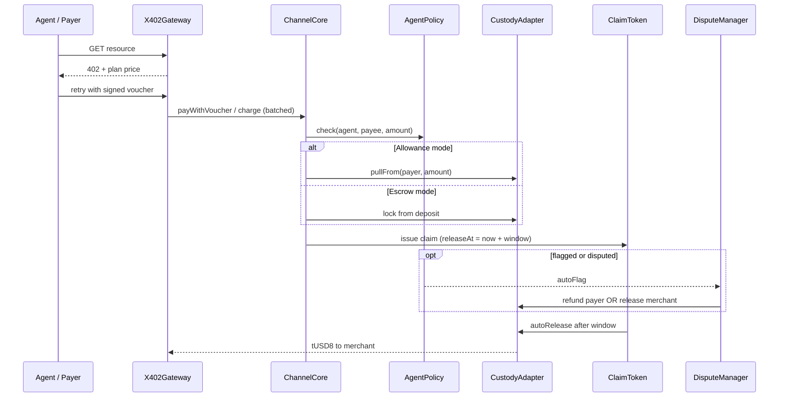

# Payment flow (sequence diagram)

Source of truth: [`aevum-payment-protocol-uml.html`](./aevum-payment-protocol-uml.html) (original, unmodified). This file is a Mermaid copy that GitHub renders inline.

